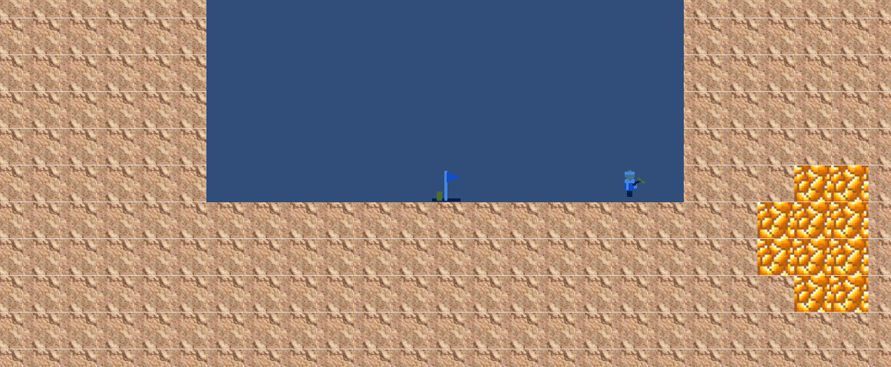
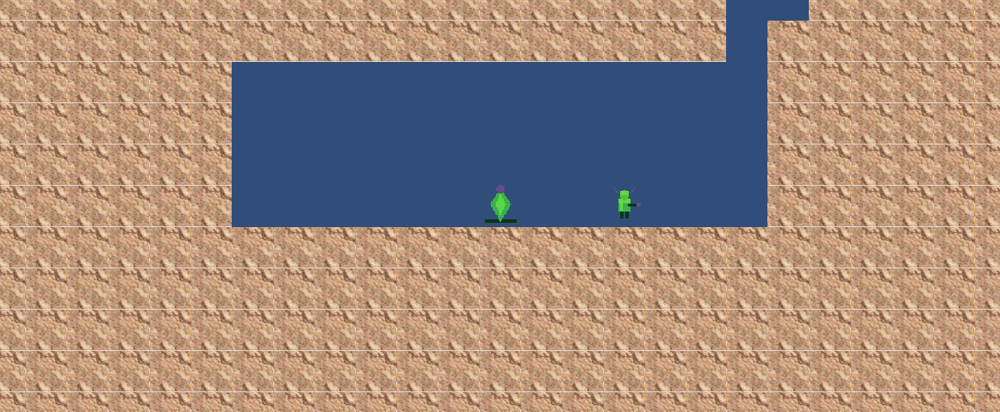
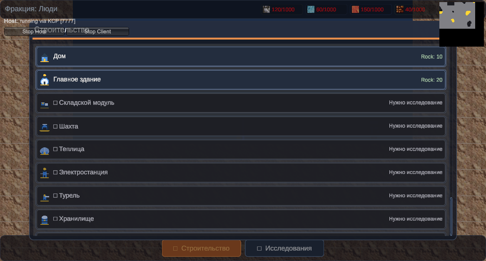
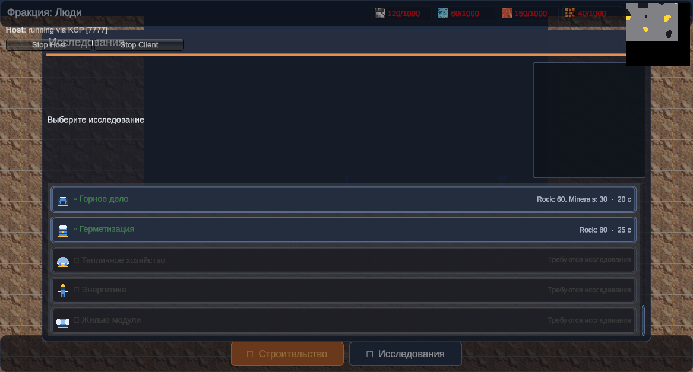

# GPOProject — Cosmo Game

2D-колония на Марсе (Unity 6, Mirror, URP 2D). Проект собран вокруг `GameKernel`
(сервис-локатор систем `IGameSystem`) и серверной авторитетной логики: клиент
рисует и отправляет команды, сервер считает экономику, юнитов и строительство.

В этой итерации доделана **система строительства** и добавлена **система фракций**
(люди и марсиане).




---

## 1. Система строительства

### Что было

- В коде было 10 скриптов зданий (`Building`, `Mine`, `Greenhouse`, `PowerPlant`,
  `Turret`, `StorageBuilding`, `LivingModule`, `ResearchLab`, `MainBuilding`,
  `ExtendsBuilding`), но префабы существовали только для трёх типов.
- `BuildingAtlas` хранил три жёстких поля (`House`, `MainBuilding`,
  `ExtendsBuilding`), а `BuilderSystem` выбирал префаб через `switch`. Остальные
  типы зданий было просто некуда положить.
- В панели строительства (`BuildingPanelUI.availableBuildings`) два слота были
  `NULL` — кнопки для них не создавались.
- Кнопки «Снести» и «Ремонт» в панели выделения были заглушками (`TODO`).
- `PlacementRule` существовал, но не был подключён к `BuildingData`; правило
  `OnBuildableSurfaceRule` всегда возвращало `false` (пыталось получить
  `Block` как `MonoBehaviour`, а `Block` — обычный C#-класс), да и классы правил
  лежали в одном файле, из-за чего Unity сохраняла ассеты правил без скрипта.

### Что сделано

| Файл | Изменение |
| --- | --- |
| `Assets/scripts/Buildings/BuildingTypeNames.cs` | Добавлены `Mine`, `Greenhouse`, `PowerPlant`, `Turret`, `StorageBuilding`, `LivingModule`, `ResearchLab` (значения enum явные — тип уходит по сети) |
| `Assets/scripts/Buildings/BuildingAtlas.cs` | Список пар «тип → префаб», `GetPrefab(type)`, `SetBuildings()` |
| `Assets/scripts/Core/Systems/BuilderSystem.cs` | Префаб берётся из атласа; проверка места (`CanPlaceBuildingAt`) вызывается и на клиенте (подсветка), **и на сервере** (защита от читов); проверяются правила размещения; зданию назначается фракция |
| `Assets/scripts/Buildings/BuildingData.cs` | Поле `PlacementRules[]` и `SatisfiesPlacementRules(position)` |
| `Assets/scripts/Buildings/PlacementRule.cs`, `NearWaterRule.cs`, `OnBuildableSurfaceRule.cs` | Правила разложены по файлам (требование Unity), `OnBuildableSurfaceRule` теперь спрашивает тип блока у `WorldSystem` |
| `Assets/scripts/Buildings/Building.cs` | SyncVar фракции (клиент рисует здание своей текстурой), серверные команды `CmdDemolish` / `CmdRepair` с проверкой владельца, чистая функция `ComputeRepairCost` |
| `Assets/scripts/UI/SelectionPanelUI.cs` | Кнопки «Снести» и «Ремонт» вызывают команды; панель не падает без `BuildingData`; в заголовке показывается фракция |

### Префабы и данные

Созданы 10 префабов в `Assets/Prefabs/Buildings/` (у каждого — нужный скрипт
здания, `NetworkIdentity`, `SpriteRenderer`, `BoxCollider2D` 1×1 и
`FactionVisuals`):

`House`, `MainBuilding`, `ExtendsBuilding`, `Mine`, `Greenhouse`, `PowerPlant`,
`Turret`, `StorageBuilding`, `LivingModule`, `ResearchLab`.

Данные (`Assets/ScriptableObjects/BuildingData/`): `HouseData`, `MineData`,
`GreenhouseData`, `PowerPlantData`, `TurretData`, `StorageBuildingData`,
`LivingModuleData`, `ResearchLabData` (+ существующие `MainBuildingData`,
`ExtendsBuildingData`).

Что ещё подключено:

- `BuildingAtlas.asset` — все 10 записей;
- `NetworkManager.spawnPrefabs` — все 10 префабов + `unit`, `FactionBase`, `NetworkSystems`;
- `BuildingPanelUI.availableBuildings` — все 10 ассетов, `NULL`-слотов больше нет;
- `MineData.PlacementRules` — правило `OnBuildableSurface` (единственное здание
  с дополнительным правилом, чтобы путь правил был задействован).

### Снос и ремонт

- Снос: `Building.CmdDemolish()` → сервер проверяет владельца → `DestroyBuilding()`
  возвращает 50 % стоимости (`ReturnResourcesOnDestroy`).
- Ремонт: `Building.CmdRepair()` → стоимость `ComputeRepairCost()` пропорциональна
  недостающему здоровью (минимум 1 единица каждого ресурса), списывается на
  сервере, здоровье восстанавливается до максимума.

---

## 2. Фракции

### Правила

- **Первый подключившийся игрок — люди, второй — марсиане**, дальше фракции
  выравниваются по количеству игроков (`FactionSpawnMath.SelectFaction`). Если
  игрок вышел, его место занимает следующий подключившийся.
- **Люди появляются на поверхности**, **марсиане — в пещере под землёй**
  (глубина `UndergroundDepth` из ассета фракции).
- **Территория расчищается для обеих фракций**: вырубается площадка
  (`ClearHalfWidth` × `ClearHeight`), под ней ставится несущий пол из камня (иначе
  здания нельзя построить), у марсиан дополнительно делается свод и наклонный
  проход на поверхность.
- **У каждой фракции свои текстуры и анимации**: спрайты юнитов (3 кадра на тип),
  спрайты всех зданий, спрайт базы, свой цвет и **свои параметры анимации**
  (кадры/с, покачивание, пульсация).

### Как это работает в сети

1. `Player.OnStartServer` → `FactionSystem.AssignFaction(player)` (если система ещё
   не зарегистрирована, попытка повторяется из `Player.Update`).
2. Сервер выбирает фракцию, пишет её в `[SyncVar] Player._faction` и ставит игрока
   в очередь на появление.
3. `FactionSystem` создаёт базу фракции: вычисляет колонку (`BaseMapFraction`),
   пол (`ClampSurfaceFloorY` для поверхности / `ComputeFloorY` для пещеры),
   расчищает территорию и спавнит маркер `FactionBase`.
4. Координаты баз — это `[SyncVar]`, поэтому клиенты **локально повторяют ту же
   расчистку** (функция детерминирована). Игрок, подключившийся позже, получает
   базы в стартовом пакете спавна и расчищает их у себя — гонять по сети каждый
   блок не нужно.
5. Точка появления игрока — `[SyncVar] Player._factionSpawn`, поэтому камера
   клиента стартует с базы, а не из нуля.
6. При подключении игрок получает стартовые ресурсы своей фракции
   (`FactionDefinition.StartingResources`), иначе строить было бы нечем.

> Важная деталь Mirror: у **незаспавненного** объекта `NetworkBehaviour.isServer`
> равно `false` (`OnStartServer` ещё не вызывался). Поэтому сеттеры, которые
> вызываются **до** `NetworkServer.Spawn` (`SetFactionServer` у `Unit`,
> `Building`, `FactionBase`), проверяют `NetworkServer.active`. Иначе значение
> молча отбрасывалось и объекты появлялись без фракции.

### Файлы

| Файл | Назначение |
| --- | --- |
| `Assets/scripts/Factions/FactionType.cs` | `None`, `Humans`, `Martians` |
| `Assets/scripts/Factions/FactionDefinition.cs` | Описание фракции: цвета, расположение базы, графика юнитов/зданий/базы, параметры анимации, стартовые ресурсы |
| `Assets/scripts/Factions/FactionAtlas.cs` | Связка `FactionType → FactionDefinition`; `Cached` из `Resources/FactionAtlas.asset` |
| `Assets/scripts/Factions/FactionSpawnMath.cs` | Чистая логика: выбор фракции, колонка базы, пол, прямоугольник расчистки, точка появления |
| `Assets/scripts/Factions/FactionSystem.cs` | Серверная система: распределение, создание баз, расчистка, точки появления |
| `Assets/scripts/Factions/FactionVisuals.cs` | Применяет спрайты/цвет/анимацию фракции к юнитам, зданиям и базе |
| `Assets/scripts/Factions/FactionBase.cs` | Сетевой маркер базы (SyncVar фракции) |
| `Assets/scripts/UI/FactionUI.cs` | HUD: «Фракция: Люди» цветом фракции |

Ассеты:

- `Assets/Resources/FactionAtlas.asset`
- `Assets/ScriptableObjects/Factions/HumansFaction.asset` (база на поверхности, x ≈ 25 % карты, синяя палитра, 4 кадра/с)
- `Assets/ScriptableObjects/Factions/MartiansFaction.asset` (пещера на 18 блоков ниже поверхности, x ≈ 72 % карты, зелёная палитра, 6 кадров/с, пульсация)
- `Assets/Sprites/Factions/{Humans,Martians}/*.png` — 40 спрайтов (заглушки-пиксель-арт,
  32×32, PPU 32, Point). Генератор: `Tools/generate_faction_sprites.py`.

### Изменённые общие системы

- `Player`: `[SyncVar]` фракции и точки появления, назначение фракции, выдача
  стартовых ресурсов, отписка от фракции при выходе.
- `Unit`: `[SyncVar]` фракции и типа юнита (ассет `UnitType` не сериализуется в
  префабе, поэтому тип передаётся отдельно), применение графики фракции.
- `Building`: `[SyncVar]` фракции → текстура здания своей фракции.
- `WorldSystem`: `ApplyBlockLocal()` для детерминированных правок без RPC;
  `CmdSpawnUnit` ставит юнита на базе фракции (поверхность или пещера) и выдаёт
  ему фракцию и тип.
- `ResourceSystem`: `IsRegistered(player)` — чтобы выдача стартовых ресурсов не
  спамила предупреждения до регистрации игрока.

### Почему база людей «на верхней границе карты»

Генератор мира (`Map.GetGeneratedBlockType`) даёт ~95 % породы: верхние слои
заполнены камнем почти во всех колонках, поэтому «поверхность» совпадает с верхней
границей карты. `ClampSurfaceFloorY` опускает пол наземной базы на `ClearHeight + 1`
блоков ниже верха, а территория наземной фракции вырубается **до самого верха
карты** — получается открытая площадка на поверхности Марса, где можно строить и
ходить. Подземная база вырубается на заданной глубине, с полом, сводом и
лестницей наверх.

---

## 3. Сборка (build)

`BuildScript` собирает два билда: `Builds\Server\Server.exe` и `Builds\Client\Client.exe`
(роль выбирается аргументами `-server` / `-client`, см. `NetworkBootstrapper`).

```powershell
unity build . --target StandaloneWindows64 --execute-method BuildScript.BuildServer
unity build . --target StandaloneWindows64 --execute-method BuildScript.BuildClient
```

### Почему сборка падала

Сборка обрывалась на шаге `GenerateNativePluginsForAssemblies`:

```
UnityEditor.Build.BuildFailedException: Burst compiler (…) failed running
Error: Burst internal compiler error: System.UnauthorizedAccessException: Отказано в доступе
   at System.IO.Path.InternalGetTempFileName(...)
   at Burst.Compiler.IL.Helpers.CommandLineArguments.WriteToTempFile(...)
```

То есть падал не код проекта, а AOT-линковщик Burst (`bcl.exe`): он не может создать
свой временный response-файл во `%TEMP%`. Воспроизводится и без изменений в игре.

### Что сделано

Для платформы Windows отключена Burst-компиляция —
`ProjectSettings/BurstAotSettings_StandaloneWindows.json`:

```json
{ "MonoBehaviour": { "EnableBurstCompilation": false } }
```

Это стандартная настройка `Jobs → Burst → Enable Compilation` для платформы. Проект
не использует Burst/Jobs (`[BurstCompile]`, `Unity.Collections` в скриптах нет),
поэтому на игру это не влияет. Проверено: **Server — Succeeded (0 ошибок),
Client — Succeeded (0 ошибок)**; собранная пара запускается, клиент подключается,
сервер выдаёт игроку фракцию `Humans`, создаёт базу (колонка 20, пол 74) и стартовые
ресурсы, клиент получает фракцию по SyncVar.

Если на машине починят доступ к `%TEMP%` (или перенесут его на доступный путь),
Burst можно включить обратно — тогда верните `true` в этом файле.

## 4. Проверка

- Компиляция: без ошибок (`recompile`).
- EditMode-тесты: **95/95** (`run_tests --mode EditMode --filter GPOProject.Tests`), из
  них новые: `FactionTests` (17) и `BuildingSystemTests` (12).
  ```powershell
  unity test . --mode EditMode --filter GPOProject.Tests
  ```
- Play Mode (Host): игрок получает `Humans`, появляется на расчищенной площадке
  (20.5, 74.5), база `FactionBase` спавнится с синим флагом, юнит — `Miner`
  фракции людей со спрайтом `unit_miner_0` и 10 HP, стартовые ресурсы выданы.
  Подземная база марсиан проверена тем же путём: пещера 62–65, каменный пол и
  свод, диагональный проход на поверхность, зелёные спрайты базы и юнита.
  Здание: спавн → спрайт `building_house` своей фракции, урон 40 → ремонт за
  4 `Rock` восстанавливает 100/100 → снос возвращает 5 `Rock`.

## 5. Синхронизация ресурсов на клиенте

### Симптом

В билде (1 сервер + 2 клиента) панель ресурсов всегда показывала `0/1000`,
хотя на сервере у игроков были стартовые ресурсы.

### Причины (три, все в клиентском пути)

1. **Строки ресурсов создавались не там.** У `ResourcePanelUI` поле
   `resourcesContainer` указывало на `Scroll View/Viewport/Content` (контейнер
   панели выделения), а `resourceDisplayPrefab` — на живой объект внутри самого
   `MainUIPrefab`. В результате пять строк создавались в чужой панели, а в HUD
   висела статичная строка с текстом из префаба, которую никто не обновлял.
2. **Клиент не публиковал события.** `ResourceChangedClientNotifier` применял
   пришедшие по `TargetRpc` значения к `player.Resources`, но не поднимал
   `ResourceChangedEvent` на локальной шине. Панель ресурсов и доступность кнопок
   строительства подписаны именно на эту шину — в режиме Host она случайно
   работала (сервер и клиент в одном процессе, одна шина), а на выделенном клиенте
   не работала вообще.
3. **Значения читались один раз.** `ResourcePanelUI` заполнял строки в `Start`,
   когда `UISystem.LocalPlayer` ещё не был назначен (UI создаётся раньше префаба
   игрока), и больше не перечитывал состояние.

### Что сделано

| Файл | Изменение |
| --- | --- |
| `Assets/Prefabs/UI/ResourceDisplay.prefab` | Отдельный префаб строки ресурса (раньше использовался объект из самого UI-префаба) |
| `Assets/Resources/MainUIPrefab.prefab` | `resourcesContainer` = `ResourcePanel`, `resourceDisplayPrefab` = новый префаб; статичная строка-заглушка удалена; иконки Rock/Minerals больше не перепутаны |
| `Assets/scripts/UI/ResourcePanelUI.cs` | Пять строк создаются в панели ресурсов; панель ждёт появления локального игрока и перечитывает его хранилище при изменении значений (работает независимо от порядка сетевых событий); событие осталось для мгновенной реакции |
| `Assets/scripts/Core/Systems/ResourceChangedClientNotifier.cs` | После применения `TargetRpc` поднимает локальное `ResourceChangedEvent`; отправляет клиенту **снимок** ресурсов (количество + лимиты) после регистрации игрока |
| `Assets/scripts/Core/Events/ResourceChangedEvent.cs` | Флаг `Local`: локально поднятые события не пересылаются обратно на сервер |
| `Assets/scripts/Player/Player.cs` | `SyncResourcesToClient()` — один снимок после регистрации в экономике |

Флаг `Local` появился не просто так: без него в режиме Host получался цикл
«событие → RPC → событие», который подвешивал редактор.

### Проверка

Запуск `Builds\Server\Server.exe -server` + два `Builds\Client\Client.exe -client`
(все три процесса живут, логи клиентов):

```
# клиент 1 — люди
[ResourcePanelUI] Ресурсы игрока: Minerals=120/1000, Ice=60/1000, Rock=150/1000, Root=40/1000, Energy=30/1000
# клиент 2 — марсиане
[ResourcePanelUI] Ресурсы игрока: Minerals=90/1000, Ice=80/1000, Rock=200/1000, Root=60/1000, Energy=40/1000
```

Значения совпадают со `StartingResources` соответствующей фракции, то есть каждый
клиент видит свои ресурсы, а не чужие и не нули.

## 6. Древо исследований

Исследования покупаются за разные ресурсы и открывают здания/юнитов либо дают
улучшения. Полностью серверная система: прогресс, списание ресурсов и проверки
делает `ResearchSystem`, клиенты получают снимок состояния.


### Модель данных

| Ассет/файл | Назначение |
| --- | --- |
| `Assets/scripts/Scince/ResearchProject.cs` | Исследование: цена (`cost` — `ResourcePair[]` в любых ресурсах), `durationSeconds`, `requiredPrerequisites`, что открывает (`unlockBuildings`, `unlockUnits`) и бонусы (`productionBonusPercent`, `unitDamageBonusPercent`, `unitHealthBonusPercent`, `researchSpeedBonusPercent`) |
| `Assets/scripts/Scince/ResearchAtlas.cs` | Упорядоченный список исследований + стартовый набор (`defaultBuildings`, `defaultUnits`); лежит в `Resources/ResearchAtlas.asset` |
| `Assets/scripts/Scince/ResearchRules.cs` | Чистые правила: `CanStart`, `AdvanceProgress`, `ComputeSpeed`, `IsBuildingUnlocked`, `IsUnitUnlocked`, `SumBonusPercent` — покрыты тестами |
| `Assets/scripts/Scince/ResearchSystem.cs` | Серверная система: состояние по игрокам, прогресс по времени, завершение, запросы доступа и бонусов |
| `Assets/scripts/Scince/ResearchSync.cs` | `NetworkBehaviour` на NetworkSystems: рассылает клиентам снимок (текущее, прогресс, изученные индексы) при изменении версии и раз в 0.4 с |
| `Assets/scripts/Scince/ResearchClientState.cs` | Клиентская копия состояния — её читают UI и проверки доступности |
| `Assets/scripts/Scince/ResearchEvents.cs` | `ResearchStartedEvent`, `ResearchCompletedEvent` на серверной шине |
| `Assets/ScriptableObjects/Research/*.asset` | 9 исследований: Горное дело, Герметизация, Тепличное хозяйство, Энергетика, Жилые модули, Оборона, Научный комплекс, Промышленная логистика, Глубинная добыча |

Дерево (стрелка = требование): Горное дело → Тепличное хозяйство / Энергетика;
Герметизация → Жилые модули → Промышленная логистика; Энергетика → Оборона;
Тепличное хозяйство + Энергетика → Научный комплекс; Промышленная логистика +
Научный комплекс → Глубинная добыча.

Изначально доступны здания Дом и Главное здание, юниты Шахтёр и Рабочий; всё
остальное открывается исследованиями.

### Как это работает

1. Кнопка в панели исследований отправляет `Player.CmdStartResearch(index)`.
2. Сервер проверяет (`ResearchRules.CanStart`): не изучено ли уже, выполнены ли
   требования, хватает ли ресурсов — и списывает стоимость.
3. `ResearchSystem.Tick` увеличивает прогресс на `deltaTime * speed`, где скорость
   = 100% + бонусы изученных технологий + 25% за каждую действующую
   `ResearchLab` владельца (лаборатория регистрируется в системе при спавне).
4. По достижении длительности исследование завершается: индекс попадает в
   завершённые, поднимается `ResearchCompletedEvent`.
5. `ResearchSync` отправляет клиенту снимок; `ResearchClientState` обновляется,
   и UI видит новые открытия.

### Геймплейные эффекты

- **Здания**: `BuilderSystem.CmdPlaceBuilding` отклоняет закрытые типы (серверная
  проверка, в обход UI не пролезть); кнопки строительства показывают 🔒 и
  «Нужно исследование» и не нажимаются.
- **Юниты**: `ResearchRules.IsUnitUnlocked` — солдат открывается исследованием
  «Оборона».
- **Бонусы**: производство зданий (`Building.ProductionMultiplier` →
  `Building.ScaleResources`), урон юнитов (`Unit.DamageMultiplier` →
  `UnitStateMachine.GetDamage`), здоровье новых юнитов (`Unit.HealthMultiplier`),
  скорость исследований.

Одновременно изучается одно исследование; панель показывает статус и процент
текущего, серым — недоступные с причиной.

### UI

- `Assets/scripts/UI/ResearchPanelUI.cs` — панель, создаёт по строке на
  исследование из `ResearchAtlas`, статус текущего исследования.
- `Assets/scripts/UI/ResearchButtonUI.cs` — строка: имя (✔/⏳/🔒/▫), стоимость,
  длительность или причина недоступности, кнопка запуска.
- `Assets/Prefabs/UI/ResearchEntry.prefab` — строка (клон кнопки здания).
- Пока окно открыто, его `Refresh()` вызывается каждый кадр из
  `UIPanelBase.Update()`: прогресс исследований и доступность зданий меняются
  сами по себе, а не только по действию игрока.

### Проверка

- EditMode: `ResearchTests` — 14 тестов (требования, прогресс, скорость,
  открытия, бонусы, целостность ассета атласа); всего в проекте 109/109.
- Play Mode (Host): старт «Горного дела» списал Rock −60 / Minerals −30, через
  20 секунд исследование завершено — в панели появилась строка «✔ Горное дело /
  Изучено», а в панели строительства кнопка «Шахта» сняла замок.

## 7. Адаптивный интерфейс

### Что было

`CanvasScaler` был в режиме `ConstantPixelSize` (референс 800×600), а панели
стояли на абсолютных якорях и позициях: окно другого размера разваливало
раскладку, панели плавали поверх поля, а переключатели были разрозненными
кнопками-соседями.

### Что стало

- **Адаптивный Canvas**: `ScaleWithScreenSize`, референс 1920×1080,
  `matchWidthOrHeight = 0.5` — интерфейс пропорционально масштабируется под
  любое окно.
- **Слои**: `HudLayer` (всегда видим), `ModalLayer` (модальные окна),
  `TooltipLayer` (подсказки).
- **HUD**: `TopBar` (растянут по ширине, прижат кверху) с фракцией и чипами
  ресурсов; `BottomBar` (прижат книзу) с кнопками «Строительство» и
  «Исследования»; панель выделения — док у правого края.
- **Модальные окна**: клик по кнопке открывает окно **поверх затемнённого
  игрового поля** (`ModalRoot` — затемнение-блокер кликов + `PanelHost` с
  отступами в процентах экрана 6–8%). Открыто не больше одного окна: открытие
  второго закрывает первое, закрываются по `Esc`, по кнопке ✕ в шапке и по
  клику на затемнение.
- **Структурные изменения для расширяемости**:
  - `UIPanelBase` — абстрактное окно (заголовок, кнопка закрытия, `Open/Close/Refresh`);
    новая панель наследуется и регистрируется — остальной код не меняется;
  - `UIPanelController` — реестр окон, переключение, затемнение, Esc;
  - `UIManager` — тонкий фасад (горячие клавиши `B` / `R` / `Esc`, подсказки);
  - списки строятся layout-группами (`VerticalLayoutGroup` +
    `ContentSizeFitter`), строки растягиваются по ширине окна;
  - `UIBuilder` (меню `Tools/UI/Перестроить интерфейс`) — пересобирает весь
    префаб UI кодом; идемпотентен, поэтому разметку можно менять кодом и не
    править YAML руками. Заодно он чистит компоненты с потерянными скриптами
    (иначе `SaveAsPrefabAsset` молча не сохраняет префаб).
- **Дизайн**: сгенерированные 9-slice спрайты (`Assets/Sprites/UI/`,
  генератор `Tools/generate_ui_sprites.py`) — панели, шапки, кнопки в трёх
  состояниях, чипы ресурсов, строки списков (normal/hover/завершено/в
  процессе/закрыто), полоса прогресса, затемнение. Единая тёмная палитра с
  марсианским акцентом; подпись фракции осветляется и получает обводку.




### Проверка

- Play Mode (окно 1161×627): TopBar/BottomBar прижаты к краям, scaleFactor
  ≈ 0.59; открытие «Строительства» → «Исследований» закрывает первое;
  `CloseAll` гасит `ModalRoot`; исследование через окно списало ресурсы,
  дошло до 98% со статусом «Герметизация — 98%» и полосой прогресса, затем
  стало зелёным «Изучено», а «Жилые модули» разблокировались; HUD-ресурсы
  обновились.
- EditMode: 109/109 тестов.

## 8. Что осталось за рамками

- Улучшение зданий (`SelectionPanelUI.UpgradeBuilding`) — по-прежнему `TODO`:
  нет данных об уровнях зданий.
- Системы населения (жилой модуль только хранит `PopulationIncrease`).
- Бой между фракциями ограничен существующей турелью/солдатом: отдельной проверки
  «свой/чужой» по фракции нет, сравниваются только владельцы.
- Спрайты фракций — программные заглушки; заменить можно, не меняя код: достаточно
  подставить свои спрайты в `FactionDefinition`.
